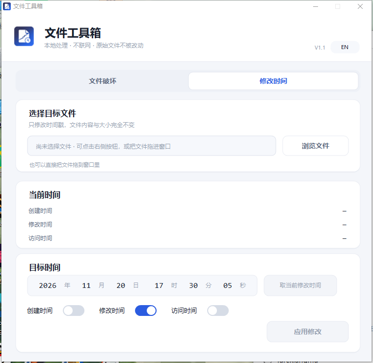
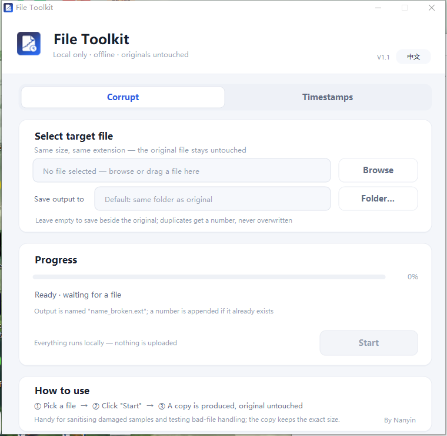
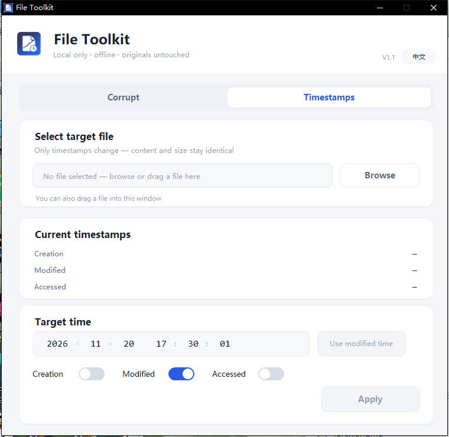

# File Toolkit · 文件工具箱

> **Download · 下载** → [**FileBreaker.exe (v1.1.0)**](https://github.com/Nanyin520/file-toolkit/releases/latest) · 免安装，双击即用 / no installer, just run it

A tiny **local-only** Windows utility with two tools in one window: make a corrupted
copy of a file, and set a file's timestamps. No install, no network, no admin rights.

---

## English

**Two tools in one window:**

1. **Corrupt** — produce a corrupted copy of any file (same size, same extension), leaving the original untouched.
2. **Timestamps** — set a file's creation / modified / accessed time to any value you type.

Nothing leaves your machine. No install, no network, no config files, no admin rights.

### Why I built this

Back in school I once forgot to submit a lab report. The teacher was collecting them
and I hadn't finished, so to buy myself some time I went online and found a
file-corruption tool. I created a fresh Word document and pasted in whatever content
I had, a few times over, purely so the file would look like it took up a plausible
number of KB — and would carry a believable creation timestamp while I was at it.
A while later the teacher told me my file wouldn't open. I said it was probably
something wrong with the machines in the lab and that the document itself had come
out corrupted. She asked me to take it back and fix it, and I handed in a revised
version afterwards. So this little tool really did buy me the extra time to polish
that report — which is, honestly, most of what it's for.

And yes, you can also use it to prank a friend you're close enough with, by
corrupting their whole file collection — back it up first, obviously.

Two ground rules: don't use it for anything illegal, and ask before running it on
someone else's computer. And always back up the original before you corrupt it.

---

## 中文

**一个窗口里两件事：**

1. **文件破坏**：生成一个与原件同大小、同后缀的损坏副本，原文件不动。
2. **修改时间**：把文件的创建 / 修改 / 访问时间改成你指定的任意时间。

不联网、不安装、不要管理员权限。

### 为什么做这个东西

给大家说一下我为什么选择做这个。

我在上学的时候有一次忘了上传实验文档，老师要收 docx 格式的作业，当时我没做完。
为了拖时间，我从网上找了一个文件破坏工具，能把任意文件破坏掉。我新建了一个 Word
文档，随便往里复制粘贴了些内容，只为了让这个文件看起来占了差不多的 KB，也顺带
有个像模像样的创建时间戳。等老师收到我的实验文档、发现打不开、全是乱码，我跟她
说可能是我的电脑环境配置出了问题、文档都乱码了。后面老师让我拿回去再修改一下，
改好了再重新上传——就这样为这次作业争取到了继续写的时间。所以这个小工具最大的
用处，就是帮你再多争取一点改正的时间。

当然，你也可以拿来整蛊自己的好朋友，把他一堆文件挨个换掉（前提是你们俩感情非常好）。

切记：请勿用于非法用途。如果要在别人的电脑上使用，请先征得对方同意再运行；并且
在破坏文件之前，务必做好备份。

---

## Screenshots · 界面




English UI:




---

## Features · 功能

| | |
|---|---|
| Corrupted copy | Streams cryptographically random bytes (`RNGCryptoServiceProvider`) into the output file, matching the original byte-for-byte in length. Progress bar with live percentage. |
| Output folder | Optional. Pick any folder, or leave empty to save next to the original. Collisions never overwrite: `name_broken.ext`, `name_broken1.ext`, … |
| Timestamps | Six-segment time editor (year / month / day / hour / minute / second). Click a segment and type, use `↑ ↓` to step, `← →` to move between segments, wheel to adjust. Tick which of the three timestamps to apply. |
| Bilingual UI | Chinese and English, switchable with the button in the top-right corner. The choice is remembered. Defaults to your system language. |
| Drag & drop | Drop a file anywhere on the window. |
| Look | Fully custom-drawn controls (rounded cards, segmented tabs, toggles, capsule progress bar) — no stock WinForms widgets. |

- 损坏副本按 64 KB 分块写入随机字节，进程内实时回报进度。
- 输出目录可选；重名自动追加序号，绝不覆盖。
- 时间编辑器支持点选分段、键盘输入自动进位、↑↓ 增减、滚轮微调。
- 中英双语，右上角一键切换并记住选择；首次启动跟随系统语言。

---

## Requirements · 运行要求

- **Windows 7 / 8 / 10 / 11** (32-bit or 64-bit — the binary is AnyCPU)
- **.NET Framework 4.x** — already present on Windows 8 and later. Windows 7 needs 4.0+ installed; if missing, Windows will prompt you with a download link.
- No other dependency. No DLL, no installer, no registry writes.

The only thing the app writes outside its own folder is the language preference, stored at
`%APPDATA%\FileBreaker\settings.txt`.

---

## Usage · 使用

1. Double-click `FileBreaker.exe`.
2. **Corrupt**: click *Browse* (or drag a file in), optionally choose an output folder, then *Start*.
3. **Timestamps**: pick a file, adjust the target time, tick the fields you want, then *Apply*.
4. Switch language any time with the `EN` / `中文` button at the top right.

---

## Build from source · 从源码编译

Single file, no project file, no third-party library — plain `csc` is enough:

```bat
"C:\Windows\Microsoft.NET\Framework64\v4.0.30319\csc.exe" ^
  /nologo /target:winexe /optimize+ /utf8output ^
  /win32icon:AppIcon.ico ^
  /out:FileBreaker.exe FileBreaker.cs
```

`AppIcon.ico` contains six PNG-compressed sizes (16 → 256 px). Version info
(product name, company, file version, copyright) is declared with `[assembly: …]`
attributes at the top of `FileBreaker.cs` and gets compiled into the exe automatically.

---

## Notes · 说明

- **Antivirus false positives** are possible. The program's whole job is writing a file
full of random bytes, which heuristic engines sometimes flag. Whitelist the exe if needed.
- The corrupted copy is *deliberately* unusable — it is intended for sanitising damaged
samples, testing error handling of file parsers, or producing junk fixtures.
- Setting timestamps requires write access to the target file's folder.
- Use it with permission. Don't point it at someone else's files without their consent,
and always keep a backup.

---

## Project layout · 目录

```
FileBreaker.cs            all source: theme, custom controls, UI, logic, version resources
AppIcon.ico               application icon (6 embedded sizes)
docs/appicon-1024.png     source artwork for the icon
docs/screenshots/         UI screenshots (zh / en)
```

---

## License · 授权

[**PolyForm Noncommercial License 1.0.0**](LICENSE) — see the `LICENSE` file for the full text.

- **Free** for personal use, study and learning, hobby projects, and any other non-commercial purpose.
- **Commercial use** (using it in a business, bundling it with a paid product, or using it as part of a service you sell) requires **prior permission** — please open an Issue or contact [@Nanyin520](https://github.com/Nanyin520) first. I'm usually happy to say yes.
- Want a different arrangement (MIT, commercial license, paid integration)? Just ask — I'm flexible.

中文说明：

- **个人使用、学习研究、非商业目的**：免费，直接下载用，不用打招呼。
- **商业用途**（在公司里用、打包进收费产品、作为你对外提供的服务的一部分）：请**先联系我**，通过本仓库 Issues 留言或找 [@Nanyin520](https://github.com/Nanyin520)。一般来说我很好说话。
- 想换更宽松的许可（比如 MIT）或者要商业授权，也可以直接谈。

---

*By Nanyin*
